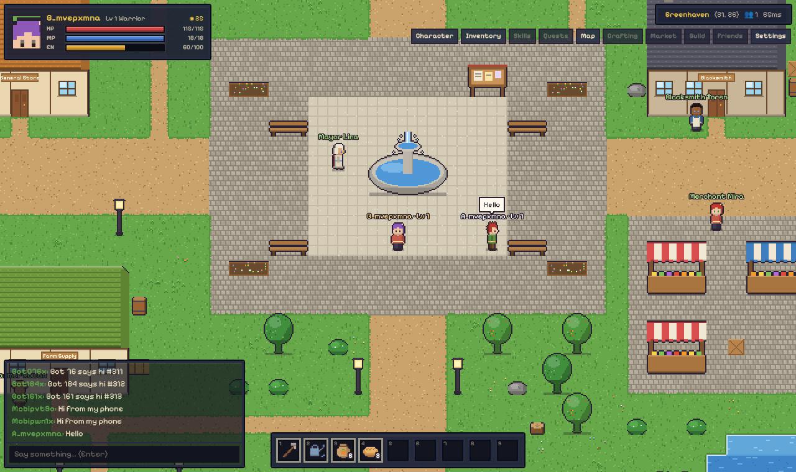
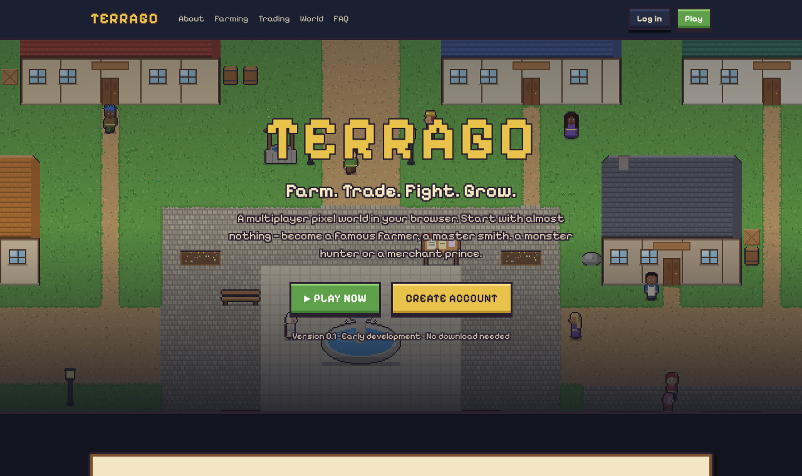
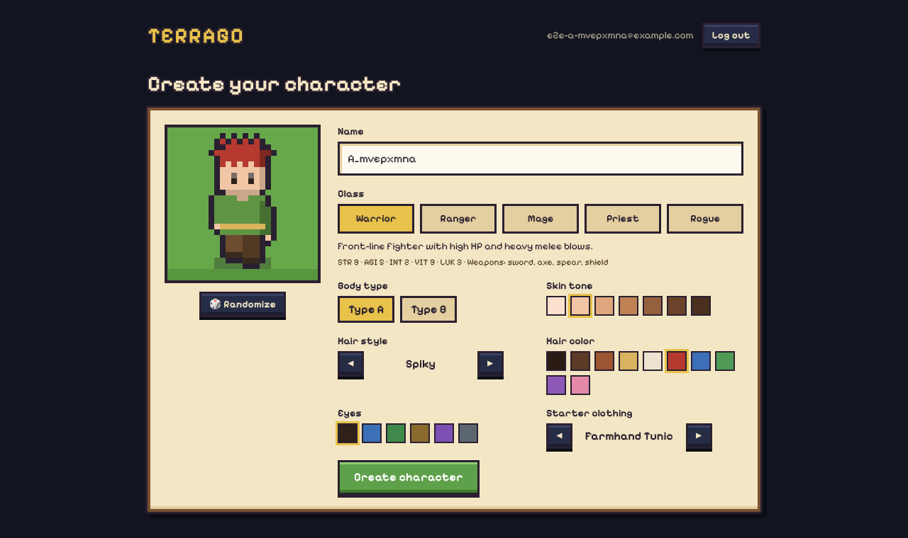
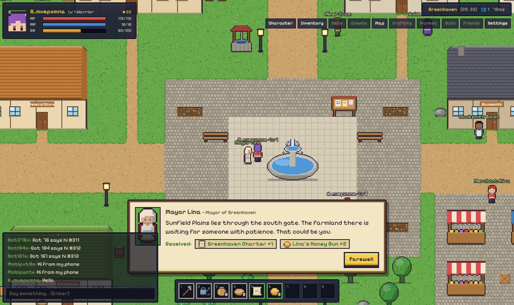
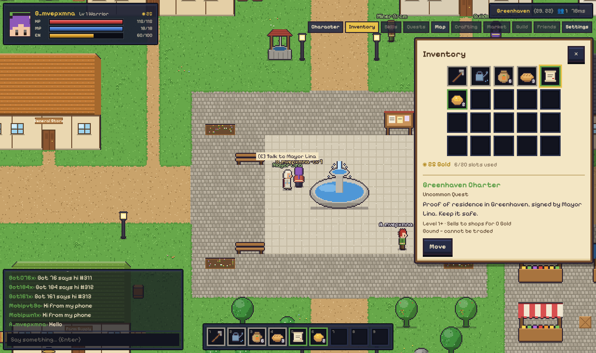
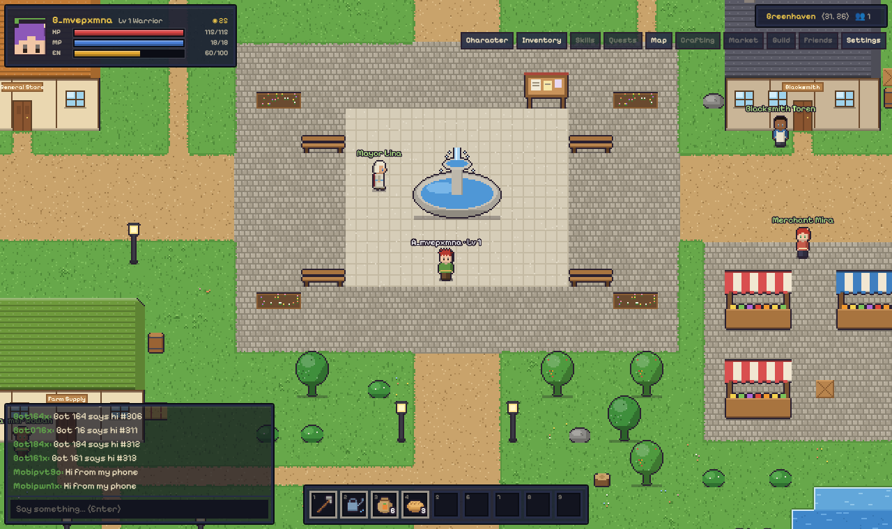
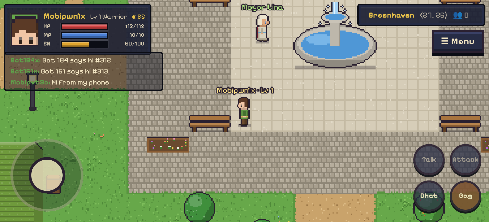

# TERRAGO

**Farm. Trade. Fight. Grow.**

TerraGo is an original browser multiplayer pixel MMORPG: a shared online world where players start with almost nothing and grow into farmers, smiths, merchants, monster hunters and guild leaders — no download required.

Current version: **0.5** — multiplayer world, farming, gathering, fishing, crafting and combat. Trading, social systems, dungeons and world events come next.



**Status:** Version 1.0 (public beta) — farming, gathering, crafting, combat, quests, marketplace and trading, parties/guilds/friends, dungeons and bosses, five regions with weather/day-night/seasons, dailies/achievements/leaderboards, admin panel and synthesized sound. 74 unit and 45 integration tests pass; browser checks cover every stage including phone screens. Details in [docs/testing.md](docs/testing.md).

## What works in v0.1

| # | Requirement | Where |
| --- | --- | --- |
| 1 | Landing page (hero, About, Farming, Combat, Trading, Crafting, World, Community, FAQ) | `apps/web/src/app/page.tsx` |
| 2–3 | Registration, login, logout, secure sessions | `apps/game-server/src/http/routes.ts`, `auth/` |
| 4–5 | Character creation (name, class, body type, skin, hair style/colour, eyes, starter clothing) and selection | `apps/web/src/app/characters`, `services/characters.ts` |
| 6 | Greenhaven (+ Sunfield Plains through the south gate) | `packages/game-data/data/maps` |
| 7 | Original generated pixel characters, tiles, props, buildings and item icons | `apps/web/src/game/art` |
| 8–10 | WASD/arrow movement, collision, following camera (+ mobile joystick) | `WorldScene.ts`, `packages/shared/src/movement.ts` |
| 11–14 | WebSocket connection, many players, name labels, movement sync with prediction/interpolation | `net/client.ts`, `world/world.ts` |
| 15 | Local chat with speech bubbles, rate limits and a profanity filter | `ChatBox.tsx`, `World.chat` |
| 16 | 20-slot inventory: stacking, moving, using food; hotbar 1–9 | `services/inventory.ts`, `Panels.tsx` |
| 17 | NPCs with original dialogue; Mayor Lina's one-time welcome gift | `game-data/data/npcs.json`, `services/npcs.ts` |
| 18–19 | Logout and persistent state (position, map, inventory, Gold, Energy) | `world.ts`, migrations |

Added since v0.1:

| Version | What | Where |
| --- | --- | --- |
| 0.2 | Personal homesteads, 14 crops (timestamp growth, quality), shops, farm tiers, Farming skill | `services/farming.ts`, `packages/shared/src/farming.ts` |
| 0.3 | Mining (40 procedural Irondeep floors), woodcutting, gathering, fishing minigame (server-replayed), 46+ recipes, Whisperwood Forest, Crystal Lake | `services/gathering.ts`, `net/fishing.ts`, `game-data/src/mapgen.ts` |
| 0.5 | Real-time PvE: monsters with AI, attacks, 15 class skills, buffs/debuffs/DoTs, equipment (9 slots), durability, death & respawn, enhancement +1..+10, loot | `world/combat.ts`, `services/equipment.ts`, `packages/shared/src/combat.ts` |

Not yet: trading/marketplace (v0.4), social systems (v0.6), dungeons and bosses (v0.7), weather/seasons (v0.8), live-game systems (v0.9). Their menu entries are visible but disabled.

## Quick start

Requirements: Node.js 20+ and PostgreSQL 16 (Docker is easiest).

```bash
cp .env.example .env
docker compose up -d db          # PostgreSQL on localhost:5432 (also creates terrago_test)
npm install
npm run dev                      # game server on :4000 (runs migrations), website on :3000
```

Open <http://localhost:3000>, create an account and a character, and press **Play**.

The website forwards its `/api` calls to the game server and the game connects to it directly; both use `http://localhost:4000` by default. To point it elsewhere, set `NEXT_PUBLIC_GAME_SERVER_URL` in `apps/web/.env.local` (Next.js reads env files from its own folder) and rebuild. To see multiplayer, open a second browser (or a private window), create another account and walk up to each other.

### Controls

| Action | Desktop | Mobile |
| --- | --- | --- |
| Move | WASD / arrow keys | Left joystick |
| Talk to NPC | E or Space | Talk button |
| Chat | Enter, type, Enter | Chat button |
| Inventory / Character / Map | I / C / M | Bag button |
| Use hotbar item | 1–9 | — |
| Settings / close | Esc | — |

## Scripts

| Command | What it does |
| --- | --- |
| `npm run dev` | Server + web with live reload |
| `npm run db:migrate` | Apply database migrations manually |
| `npm test` | Unit + integration tests (integration needs the `terrago_test` database) |
| `npm run test:e2e` | **The v0.1 success test** in two real browsers (needs `npm run dev` running) |
| `npm run loadtest -- --bots 100 --duration 120` | 100 bot players against a running server (start it with `DISABLE_RATE_LIMITS=true`) |
| `npm run maps:generate` | Regenerate map JSON from the map script |
| `npm run build` | Production builds (server bundle + Next.js) |
| `npm run build:preview -w @terrago/web` | Single-page offline preview (the whole game in one HTML file, single-player) |

## Project structure

```
apps/
  web/            Next.js + React + Tailwind website, Phaser game client
  game-server/    Authoritative Node.js server: REST API, Socket.IO, 20 Hz world, persistence
packages/
  shared/         Protocol types + deterministic rules shared by client and server
  game-data/      Items, classes, NPCs, maps, balance (JSON)
  database/       PostgreSQL migrations + runner
scripts/          dev runner, two-browser e2e test, load test
deploy/           Dockerfile, production compose, Caddyfile, backups
docs/             architecture, deployment, testing
```

## Screenshots

| | |
| --- | --- |
|  |  |
|  |  |
|  |  |

## Documentation

* [Architecture](docs/architecture.md) — networking model, anti-cheat, persistence, security, scaling path
* [Free deployment](docs/deploy-free.md) — Vercel + Render + Neon, no domain or payment needed
* [Production deployment](docs/deployment.md) — Vercel (web) + Singapore VPS (game server, PostgreSQL, Caddy) + your domain, backups
* [Testing](docs/testing.md) — what is tested and the latest results
* [Operations](docs/operations.md) — backups, uptime alerts, logs (do this before inviting players)

## Principles

* **The server is authoritative.** Clients send intent; the server decides positions, items, Gold and outcomes.
* **No duplication.** Every item and Gold change is a database transaction with a ledger entry.
* **No pay-to-win.** Progress comes from time, skill, knowledge and cooperation.
* **Original.** Every map, character, NPC, line of dialogue and pixel of art in this repository was made for TerraGo.
